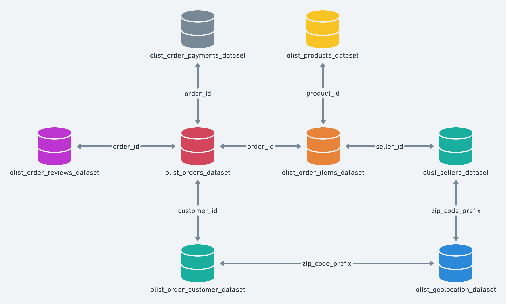
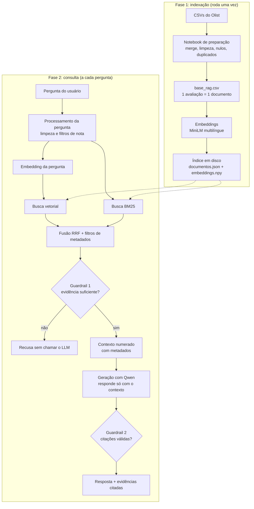
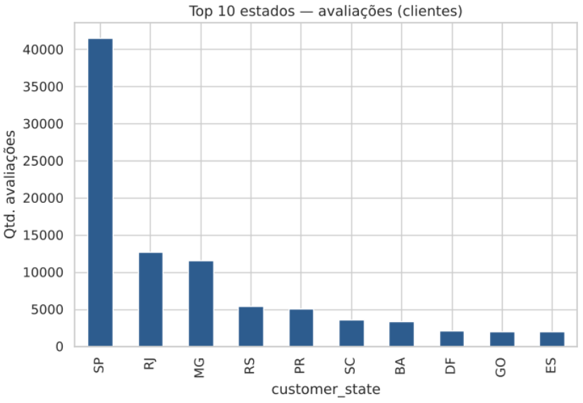

# Voice of Customer Intelligence com RAG (Olist)

Projeto do **Tech Challenge Fase 4** da PosTech. Uma solução de Retrieval-Augmented Generation (RAG) que permite a gestores e analistas fazerem perguntas em linguagem natural sobre as avaliações de clientes de um e-commerce e receberem respostas **fundamentadas em avaliações reais**, com a lista das evidências que sustentam cada resposta.

> **Equipe:** Igor Paganin, Leandro Vieira e Thiago Baience
> **Vídeo de apresentação:** [inserir link]

---

## Sumário

1. [Problema de negócio](#1-problema-de-negócio)
2. [Base de dados](#2-base-de-dados)
3. [Arquitetura](#3-arquitetura)
4. [Tecnologias e bibliotecas](#4-tecnologias-e-bibliotecas)
5. [Estrutura do repositório](#5-estrutura-do-repositório)
6. [Preparação da base](#6-preparação-da-base)
7. [Estratégia do pipeline RAG](#7-estratégia-do-pipeline-rag)
8. [Tratamento de perguntas sem evidência (guardrails)](#8-tratamento-de-perguntas-sem-evidência-guardrails)
9. [Como instalar e executar](#9-como-instalar-e-executar)
10. [Como usar a CLI (`ask.py`)](#10-como-usar-a-cli-askpy)
11. [Filtros e avisos importantes](#11-filtros-e-avisos-importantes)
12. [Avaliação da qualidade do RAG](#12-avaliação-da-qualidade-do-rag)
13. [Exemplos de perguntas e respostas](#13-exemplos-de-perguntas-e-respostas)
14. [Justificativa das principais decisões técnicas](#14-justificativa-das-principais-decisões-técnicas)
15. [Limitações e melhorias futuras](#15-limitações-e-melhorias-futuras)
16. [Solução de problemas](#16-solução-de-problemas)

---

## 1. Problema de negócio

Empresas de e-commerce recebem milhares de avaliações escritas. As notas permitem medir a satisfação, mas os melhores insights estão nos **comentários em texto**: quais problemas se repetem, o que os clientes elogiam, o que aparece nas avaliações de quem ficou insatisfeito. Ler tudo manualmente é lento e pouco escalável.

Esta solução transforma os comentários em uma base de conhecimento explorável. O usuário pergunta, o sistema recupera as avaliações mais relevantes, usa essas avaliações como contexto para um modelo de linguagem e devolve uma resposta com **rastreabilidade**: é possível ver exatamente quais avaliações sustentam cada afirmação. Quando não há evidência suficiente, o sistema **busca recusar a resposta** em vez de inventar, com as limitações descritas nas seções 8 e 15.

Exemplos de perguntas que a solução responde:

- Quais reclamações relacionadas à entrega aparecem com mais frequência?
- O que os clientes mais elogiam em suas experiências de compra?
- Quais problemas são relatados por clientes insatisfeitos?
- Existem padrões recorrentes nas avaliações sobre a qualidade dos produtos?

## 2. Base de dados

[Brazilian E-Commerce Public Dataset by Olist](https://www.kaggle.com/datasets/olistbr/brazilian-ecommerce/data), com cerca de 100 mil pedidos realizados entre 2016 e 2018. Consulte a licença de uso na página do Kaggle.

Arquivos utilizados (colocar em `data/raw/`):

| Arquivo | Uso |
|---|---|
| `olist_order_reviews_dataset.csv` | tabela central: nota e comentário de cada avaliação |
| `olist_orders_dataset.csv` | status do pedido e datas (compra, entrega, previsão) |
| `olist_customers_dataset.csv` | cidade e estado do cliente |
| `olist_geolocation_dataset.csv` | coordenadas por CEP |
| `olist_order_items_dataset.csv` | itens de cada pedido (ponte para os produtos) |
| `olist_products_dataset.csv` | categoria de cada produto |



Os arquivos de pagamentos, vendedores e a tabela de tradução de categorias **não são usados**. As categorias permanecem em português, exatamente como vêm no dataset (por exemplo, `beleza_saude`, `informatica_acessorios`).

## 3. Arquitetura

O projeto tem duas fases: uma **indexação** feita uma única vez e uma **consulta** executada a cada pergunta.



Fluxo em texto: **pergunta, processamento da pergunta, embedding, recuperação híbrida, construção do contexto, geração da resposta, resposta fundamentada nas evidências recuperadas.**

## 4. Tecnologias e bibliotecas

| Componente | Tecnologia |
|---|---|
| Linguagem | Python |
| Manipulação de dados | `pandas`, `numpy` |
| Embeddings | `sentence-transformers` com o modelo `paraphrase-multilingual-MiniLM-L12-v2` (384 dimensões) |
| Busca lexical | `rank-bm25` (BM25Okapi) |
| Busca vetorial | similaridade de cosseno em `numpy` (busca exata) |
| Fusão de rankings | Reciprocal Rank Fusion (RRF), implementado no projeto |
| Modelo de linguagem | `Qwen/Qwen2.5-1.5B-Instruct`, executado localmente via `transformers` e `torch` |
| Interface | CLI em Python (`argparse`) |

Todo o processamento roda **localmente**, sem APIs pagas e sem enviar dados para serviços externos.

## 5. Estrutura do repositório

```
tech-challenge-fase4/
├── README.md
├── requirements.txt
├── data/
│   ├── raw/                     # CSVs do Kaggle (não versionados)
│   └── processed/               # base_rag.csv e base completa, geradas pelo notebook
├── notebooks/
│   └── processamento_EDA_bases.ipynb # merge, limpeza e geração da base do RAG e analise exploratória da base completa
├── src/
│   ├── config.py                # parâmetros do projeto (modelos, top-k, limiares)
│   ├── ingestion.py             # leitura do base_rag.csv
│   ├── documents.py             # montagem dos documentos (texto + metadados)
│   ├── embeddings.py            # geração dos embeddings
│   ├── vectorstore.py           # salvar, carregar e buscar no índice vetorial
│   ├── retriever.py             # processamento da pergunta, BM25, RRF e filtros
│   ├── context.py               # construção do contexto enviado ao LLM
│   ├── generator.py             # prompt e geração da resposta
│   ├── guardrails.py            # tratamento de evidência insuficiente
│   ├── evaluation.py            # perguntas de avaliação e métricas
│   └── pipeline.py              # junta todas as etapas: pergunta, resposta, evidências
├── scripts/
│   ├── build_index.py           # indexação (roda uma vez)
│   ├── ask.py                   # CLI interativa de perguntas
│   └── evaluate.py              # avaliação da recuperação e dos guardrails
├── indice/                      # gerado pelo build_index.py (não versionado)
└── docs/
    └── imgs/                    # prints: exemplos, evidências, guardrails e métricas
```

Cada arquivo de `src/` cumpre uma etapa do pipeline, e o `pipeline.py` reúne todas elas na função `responder()`.

## 6. Preparação da base

Feita no notebook `notebooks/processamento_EDA_bases.ipynb`, que gera dois arquivos em `data/processed/`:

- `base_avaliacoes_completa.csv`: todas as avaliações (com e sem comentário) e os metadados.
- `base_rag.csv`: somente avaliações **com comentário**, que alimentam o RAG.

### Seleção e junção dos dados

Todas as junções partem da tabela de avaliações (`left join`) e usam `validate=` do pandas para garantir que nenhuma linha seja multiplicada por chaves repetidas:

```
avaliações > pedidos (order_id) > clientes (customer_id) > geolocalização (CEP)
                  └ itens do pedido (order_id) > produtos (product_id)
```

### Tratamento de duplicados

| Situação | Tratamento |
|---|---|
| Linhas 100% duplicadas | removidas em todas as tabelas |
| Pedido com mais de uma avaliação | mantida a mais recente, deixando `order_id` único (o `review_id` não é único no dataset) |
| Geolocalização com várias coordenadas por CEP | agregada por CEP (mediana de latitude e longitude), após descartar coordenadas fora do Brasil |
| Itens de um mesmo pedido | agregados em `n_itens`, `categoria_principal` (a mais frequente) e `categorias` (todas) |
| Textos de comentário idênticos (ex.: "Ótimo") | unificados na base do RAG, guardando a frequência em `n_ocorrencias` |

### Tratamento de valores ausentes

| Campo | Tratamento |
|---|---|
| Título e mensagem do comentário nulos | viram texto vazio. Avaliações sem texto utilizável ficam fora da base do RAG |
| Comentários muito curtos | tratados como "sem comentário" (limite configurável no notebook) |
| Datas de entrega nulas | **não são imputadas**: significam pedido cancelado ou não entregue. Por isso `entregue_com_atraso` fica nulo nesses casos |
| Categoria nula do produto | rótulo `sem_categoria` |
| Pedido sem itens registrados | rótulo `sem_itens` |
| Coordenadas ausentes | permanecem nulas, pois não faz sentido inventar localização |

### Organização dos documentos

Cada avaliação é um documento, composto pelo texto (título e mensagem juntos) e por metadados que acompanham o texto até a resposta final: nota, data, estado, cidade, categorias, indicadores de atraso e frequência do texto. Não há *chunking*, porque as avaliações já são textos curtos.

## 7. Estratégia do pipeline RAG

### 7.1 Processamento da pergunta (`retriever.py`)

A pergunta é limpa e analisada em busca de termos que indicam um **filtro de nota**:

| Termos na pergunta | Filtro aplicado |
|---|---|
| "nota 3", "nota de 3", "nota igual a 3" (1 a 5) | nota exatamente igual ao valor citado |
| "insatisfeitos", "nota baixa", "avaliações negativas", "reclama..." | nota menor ou igual a 2 |
| "elogi...", "satisfeitos", "nota alta", "avaliações positivas" | nota maior ou igual a 4 |

Quando a nota é citada explicitamente, a expressão (por exemplo, "com a nota 3") é **removida do texto usado na busca**, para não contaminar a recuperação com o número. O modelo de linguagem, porém, recebe a pergunta original. Os filtros automáticos podem ser desligados com `--sem-filtros`.

### 7.2 Recuperação híbrida (`retriever.py` e `vectorstore.py`)

1. **Busca vetorial (semântica):** a pergunta vira um vetor e é comparada, por cosseno, com os vetores de todas as avaliações elegíveis.
2. **Busca BM25 (lexical):** pontua as avaliações pelas palavras em comum. A tokenização remove acentos e stopwords, para que "nao chegou" e "não chegou" sejam tratados igual. Só entram na fusão avaliações com pontuação maior que zero.
3. **Fusão por RRF:** cada busca entrega 30 candidatos e o Reciprocal Rank Fusion soma `1 / (60 + posição)` de cada ranking. Quem aparece bem nas duas buscas sobe no resultado final.
4. **Filtros de metadados:** aplicados **antes** das duas buscas (pré-filtragem), por meio de uma máscara que deixa de fora os documentos que não atendem aos critérios.
5. **Seleção final:** as 8 primeiras avaliações do RRF (`TOP_K`).

### 7.3 Construção do contexto (`context.py`)

As avaliações são numeradas e acompanhadas de seus metadados, o que permite a citação e a rastreabilidade.

Exemplo:

```
[1] (nota 2 | SP | beleza_saude | id 1864e415)
COMPREI DOIS SO ENTREGARAM 1
```

Avaliações longas são truncadas em 400 caracteres. Quando um comentário idêntico foi repetido por vários clientes, isso é informado no contexto.

### 7.4 Geração (`generator.py`)

O modelo recebe um prompt de sistema que o instrui a:

- responder **apenas** com base nas avaliações numeradas;
- destacar temas e padrões, sem inventar;
- **não afirmar percentuais, totais ou "a maioria dos clientes"**, já que ele enxerga somente uma amostra;
- terminar sempre com uma linha `Fontes: [n, n]`;
- dizer exatamente a mensagem padrão de recusa quando as avaliações não contiverem a resposta.

A geração é determinística (`do_sample=False`).

### 7.5 Parâmetros do `config.py`

Todos os parâmetros ajustáveis ficam em `src/config.py`:

| Parâmetro | Valor | Função e justificativa |
|---|---|---|
| `MODELO_EMBEDDINGS` | `paraphrase-multilingual-MiniLM-L12-v2` | modelo leve e multilíngue, com bom suporte a português |
| `MODELO_GERACAO` | `Qwen2.5-1.5B-Instruct` | modelo pequeno, executável localmente em CPU |
| `TOP_K` | 8 | avaliações recuperadas. Perguntas agregadas precisam de mais exemplos que os 3 usados em aula, e 8 trechos curtos cabem bem no contexto |
| `CANDIDATOS_POR_BUSCA` | 30 | candidatos que cada busca (BM25 e vetorial) entrega para a fusão RRF |
| `RRF_K` | 60 | constante usual do Reciprocal Rank Fusion |
| `NOTA_MAX_NEGATIVA` | 2 | notas 1 e 2 são tratadas como insatisfação nos filtros automáticos |
| `NOTA_MIN_POSITIVA` | 4 | notas 4 e 5 são tratadas como satisfação (a nota 3 é considerada neutra) |
| `LIMIAR_MELHOR_SIMILARIDADE` | 0.35 | similaridade mínima da melhor avaliação (guardrail 1) |
| `LIMIAR_EVIDENCIA` | 0.25 | similaridade mínima para uma avaliação ir ao contexto |
| `MIN_EVIDENCIAS` | 2 | mínimo de avaliações relevantes para tentar responder |
| `MAX_CHARS_EVIDENCIA` | 400 | evita que comentários longos dominem o contexto |
| `MAX_NEW_TOKENS` | 300 | respostas curtas e diretas |

Os parâmetros de recuperação e de geração foram mantidos nos valores iniciais. A avaliação (seção 12) não indicou ajuste que se justificasse com o conjunto de perguntas disponível, e os limiares são discutidos na seção 8.

## 8. Tratamento de perguntas sem evidência (guardrails)

O desafio exige que o sistema reconheça os limites da base. Há duas camadas, implementadas em `guardrails.py`.

**Camada 1, antes da geração.** O sistema recusa **sem chamar o modelo** (e portanto sem possibilidade de alucinação) quando:

| Condição | Significado |
|---|---|
| nenhuma avaliação recuperada | filtros restritivos demais ou nenhum termo em comum |
| melhor similaridade menor que `LIMIAR_MELHOR_SIMILARIDADE` | pergunta provavelmente fora do escopo da base |
| menos de `MIN_EVIDENCIAS` avaliações com similaridade mínima (`LIMIAR_EVIDENCIA`) | evidências insuficientes |

Além disso, avaliações com similaridade abaixo de `LIMIAR_EVIDENCIA` são descartadas e **não chegam ao modelo**.

**Camada 2, depois da geração.** O sistema confere se:

- o modelo respondeu com a mensagem de recusa (e então a marca como recusa);
- a resposta traz uma linha `Fontes` com números que existem de fato no contexto. Sem citação válida, aparece o aviso de que a resposta não está fundamentada.

Valores utilizados (em `src/config.py`):

| Parâmetro | Valor |
|---|---|
| `LIMIAR_MELHOR_SIMILARIDADE` | 0.35 |
| `LIMIAR_EVIDENCIA` | 0.25 |
| `MIN_EVIDENCIAS` | 2 |


## 9. Como instalar e executar

### Requisitos

- Python 3.11 ou superior (recomendado) e `git`.
- Cerca de 4 GB livres em disco para os modelos baixados na primeira execução (o Qwen ocupa cerca de 3 GB).
- Funciona em CPU. Com GPU compatível com CUDA, a geração fica bem mais rápida.
- Conexão com a internet apenas na primeira execução, para baixar os modelos.

### Passo a passo

**1. Clonar e preparar o ambiente**

```bash
git clone [url-do-repositório]
cd tech-challenge-fase4

python -m venv .venv
source .venv/bin/activate          # Windows: .venv\Scripts\activate
pip install -r requirements.txt
```

**2. Baixar a base**

Baixe o dataset no [Kaggle](https://www.kaggle.com/datasets/olistbr/brazilian-ecommerce/data) e coloque os CSVs listados na seção 2 em `data/raw/`.

**3. Preparar a base do RAG**

Execute o notebook `notebooks/processamento_EDA_bases.ipynb` do início ao fim. Ao final, confira se existe `data/processed/base_rag.csv`.

**4. Construir o índice (uma única vez)**

```bash
python scripts/build_index.py --limite 2000   # teste rápido, opcional
python scripts/build_index.py                 # base completa (alguns minutos em CPU)
```

Isso gera a pasta `indice/` com `documentos.json` e `embeddings.npy`. Se a base for alterada, o índice precisa ser refeito.

**5. Fazer perguntas**

```bash
python scripts/ask.py
```

**6. Avaliar a solução**

```bash
python scripts/evaluate.py                    # recuperação e guardrails, sem o LLM
python scripts/evaluate.py --com-geracao      # também gera as respostas e confere as citações
```

OBS: Execute sempre os comandos a partir da **pasta raiz** do projeto.

## 10. Como usar a CLI (`ask.py`)

### Modos de uso

```bash
python scripts/ask.py                                  # modo interativo
python scripts/ask.py "Quais problemas de entrega?"    # pergunta única
```

No **modo interativo**, os modelos são carregados uma vez e é possível fazer várias perguntas seguidas (digite `sair` para encerrar). Na pergunta única, os modelos são recarregados a cada execução, por isso o modo interativo é bem mais rápido para várias perguntas.

### Opções

| Opção | O que faz | Exemplo |
|---|---|---|
| `--k N` | quantas avaliações recuperar (padrão: 8) | `--k 12` |
| `--so-recuperacao` | não carrega nem chama o LLM, mostra apenas a busca (rápido, bom para testes) | |
| `--sem-filtros` | desliga os filtros automáticos de nota deduzidos da pergunta | |
| `--estado UF` | considera só clientes do estado indicado | `--estado SP` |
| `--categoria TEXTO` | considera só pedidos que contenham a categoria | `--categoria beleza_saude` |
| `--com-atraso` | considera só pedidos entregues **com** atraso | |
| `--sem-atraso` | considera só pedidos entregues **no prazo** | |

`--com-atraso` e `--sem-atraso` não podem ser usados juntos. As opções podem ser combinadas:

```bash
python scripts/ask.py --estado RJ --categoria informatica --com-atraso
```

**Importante:** as opções são informadas **ao iniciar o script** e valem para todas as perguntas daquela sessão. Escrever `--com-atraso` dentro do texto da pergunta **não** aplica o filtro (o texto vira parte da consulta). Para trocar de filtro, saia com `sair` e inicie de novo.

### Como ler a saída

A CLI mostra cada etapa do pipeline:

| Etapa | Conteúdo |
|---|---|
| [1] Processamento da pergunta | consulta limpa e filtros aplicados |
| [2] Recuperação | avaliações encontradas, com `cos=` (similaridade de cosseno), posição na busca vetorial (`vet#`) e na BM25 (`bm25#`), além de nota, estado, categoria e id |
| [3] Guardrail | `ok` ou `RECUSA`, com o motivo |
| [4] Contexto | quantas avaliações foram enviadas ao modelo |
| [5] Resposta | texto gerado e tempo de geração |
| [6] Evidências citadas | texto completo das avaliações citadas em `Fontes` |

Dois detalhes para interpretar a etapa [2]:

- A lista mostra apenas o **top-k** da fusão, e não todas as avaliações da base.
- A ordem segue o **RRF**, não o `cos=`. Uma avaliação encontrada pelas duas buscas pode aparecer acima de outra com `cos=` maior que só foi achada em uma delas. `vet#-` ou `bm25#-` indica que o documento não estava entre os 30 candidatos daquela busca.

## 11. Filtros e avisos importantes

Os filtros enriquecem a recuperação com metadados, mas **reduzem a base consultada**. Leia estes avisos antes de interpretar os resultados.

### Filtro de região (`--estado`)



**Este é o filtro que mais limita a base.** As avaliações do Olist são muito concentradas em poucos estados, especialmente SP, RJ e MG. Em estados com pouco volume, o número de avaliações **com comentário** é pequeno, e combinar o estado com nota, categoria ou atraso pode deixar apenas algumas dezenas de documentos, ou menos.

Consequências:

- a etapa [2] da CLI mostra `documentos elegíveis após filtro`: **olhe esse número sempre que usar filtros**;
- poucos documentos significam que o top-k traz avaliações pouco relacionadas à pergunta, e as respostas passam a refletir pouquíssimas pessoas;
- se restarem menos avaliações relevantes que `MIN_EVIDENCIAS`, o sistema recusa, e isso é o comportamento esperado;
- as conclusões **não devem ser generalizadas** para a região como um todo.

### Filtro de categoria (`--categoria`)

- A busca é por trecho do nome e usa o campo `categorias`, que lista **todas** as categorias do pedido. Um pedido com itens de categorias diferentes aparece em mais de uma delas.
- Os nomes são os do dataset, em português e com sublinhado (por exemplo, `beleza_saude`). Não há tradução.
- Pedidos sem itens registrados têm categoria `sem_itens` e nunca casam com uma categoria específica.
- A avaliação é do **pedido**, e não de um produto específico. Em pedidos com vários itens, o comentário pode se referir a qualquer um deles.

### Filtros de atraso (`--com-atraso` e `--sem-atraso`)

- Consideram apenas pedidos **entregues**, nos quais é possível comparar a data de entrega com a prevista.
- Pedidos cancelados ou ainda não entregues têm o campo nulo e **ficam de fora dos dois filtros**. Isso é intencional: nada garante que um pedido não entregue tenha "chegado no prazo".
- Cuidado com combinações contraditórias, como `--com-atraso` com uma pergunta sobre "pedidos que chegaram no prazo".

### Filtros automáticos de nota

- Dependem de **palavras-chave** na pergunta (tabela da seção 7.1). A palavra "reclama..." aplica nota menor ou igual a 2, o que deixa de fora reclamações feitas em avaliações de nota 3.
- Se a pergunta não contém esses termos, nenhum filtro de nota é aplicado.
- Use `--sem-filtros` para ver o resultado sem o filtro automático.

### Outros avisos gerais

- **A resposta é baseada em uma amostra.** O modelo vê no máximo 8 avaliações. Perguntas como "quais os principais problemas?" refletem esses trechos, e **não a frequência real** dos problemas na base. Por isso o prompt proíbe percentuais e totais.
- **Textos idênticos foram unificados.** Em comentários repetidos (ex.: "Recomendo"), os metadados guardados são os da avaliação mais recente, e a quantidade de repetições fica em `n_ocorrencias`. Filtros por metadados podem, portanto, subestimar esses comentários.
- **Ruído lexical.** Palavras que descrevem a própria tarefa (como "comentários") podem trazer avaliações irrelevantes pela busca BM25. O guardrail e o corte por similaridade reduzem esse efeito, mas não o eliminam.
- **Modelo pequeno.** O Qwen de 1,5 bilhão de parâmetros roda em máquinas comuns, mas às vezes ignora o formato de citação. Nesses casos, a CLI exibe o aviso de que a resposta não trouxe citações válidas, e ela deve ser tratada como não fundamentada.
- **Dados antigos e informais.** As avaliações são de 2016 a 2018, em português coloquial, com erros de digitação, abreviações e emojis.

## 12. Avaliação da qualidade do RAG

O script `scripts/evaluate.py` usa as perguntas definidas em `src/evaluation.py` (válidas, fora de escopo e sem evidência) e mede:

| Métrica | O que mede |
|---|---|
| **Precision@k** | dos k trechos recuperados, quantos são relevantes para a pergunta |
| **Hit rate** | em quantas perguntas pelo menos um trecho relevante foi recuperado |
| **Latência** | tempo médio da recuperação |
| **Recusa correta** | perguntas fora de escopo ou sem evidência que o sistema recusou |
| **Falsa recusa** | perguntas válidas que o sistema recusou indevidamente |
| **Citações válidas** (com `--com-geracao`) | respostas que trazem citações que existem no contexto |

O gabarito das perguntas válidas é feito por palavras-chave: um trecho recuperado conta como relevante se contém alguma delas e, quando definido, se a nota está na faixa esperada. É uma aproximação, e não uma anotação manual completa.

O script compara três estratégias de recuperação: **vetorial pura**, **BM25 pura** e **híbrida (BM25 + vetorial + RRF)**, e inclui uma seção de **calibração** dos limiares dos guardrails.

### Resultados

Conjunto de avaliação: **17 perguntas** (10 válidas, 4 fora do escopo e 3 sem evidência), top-8, sobre a base de 35.027 avaliações. Os prints completos da execução estão em `docs/imgs/`.

#### Recuperação (10 perguntas válidas)

| Estratégia | Precision@8 | Hit rate | Latência média |
|---|---|---|---|
| Vetorial pura | 0,69 | 100% | 265 ms |
| BM25 pura (lexical) | 0,57 | 100% | 207 ms |
| Híbrida (BM25 + vetorial + RRF) | 0,61 | 100% | 185 ms |


Leitura dos resultados:

- A **busca vetorial pura obteve a maior precision@8**, a BM25 a menor, e a híbrida ficou entre as duas. Neste conjunto, **a fusão não superou a busca vetorial**.
- O **hit rate de 100% nas três estratégias não discrimina**: com 8 trechos por pergunta, é fácil que ao menos um contenha alguma palavra-chave do gabarito.
- A diferença entre 0,69 e 0,61 equivale a cerca de 6 trechos entre 80 avaliados. Com apenas 10 perguntas e um gabarito por palavras-chave, **não é uma diferença conclusiva**.
- A hipótese para a BM25 ficar atrás é que ela traz ruído de palavras genéricas ("entrega", "não", "clientes") e não entende negação (por exemplo, "entrega sem problemas" casa com uma busca por problemas de entrega), e o RRF repassa parte desse ruído ao resultado final.
- As latências são da mesma ordem de grandeza. A vetorial é a primeira a ser executada e provavelmente inclui o aquecimento dos modelos, então a comparação de tempo é apenas indicativa.

#### Guardrails (17 perguntas, com geração)

| Tipo | Pergunta | Comportamento | Similaridade | Avaliação |
|---|---|---|---|---|
| válida | Quais reclamações sobre atraso na entrega aparecem com mais frequência? | respondeu | 0,77 | correto |
| válida | O que os clientes relatam sobre produtos que chegaram quebrados ou com defeito? | respondeu | 0,69 | correto |
| válida | Existem reclamações de pedidos que nunca chegaram? | respondeu | 0,75 | correto |
| válida | O que os clientes mais elogiam na experiência de compra? | respondeu | 0,78 | correto |
| válida | Quais elogios aparecem sobre a rapidez da entrega? | respondeu | 0,83 | correto |
| válida | O que clientes insatisfeitos dizem sobre o atendimento do vendedor? | respondeu | 0,79 | correto |
| válida | Há reclamações de que o produto é diferente do anunciado? | respondeu | 0,83 | correto |
| válida | Quais problemas aparecem nas avaliações com nota 1? | respondeu | 0,58 | correto |
| válida | O que os clientes relatam sobre o prazo de entrega? | respondeu | 0,83 | correto |
| válida | Quais problemas são relatados em produtos de informática? | respondeu | 0,54 | correto |
| fora do escopo | Qual a capital da França? | recusou | 0,49 | correto |
| fora do escopo | Como funciona um motor de foguete? | recusou | 0,57 | correto |
| fora do escopo | Quem ganhou a Copa do Mundo de 2002? | recusou | 0,52 | correto |
| fora do escopo | Qual é a melhor receita de bolo de chocolate? | recusou | 0,63 | correto |
| sem evidência | Os clientes reclamam do aplicativo de celular da loja? | **respondeu** | 0,66 | **erro** |
| sem evidência | O que dizem sobre a política de devolução para compras feitas no exterior? | recusou | 0,64 | correto |
| sem evidência | Há relatos de problemas com o programa de fidelidade e pontos? | recusou | 0,55 | correto |


| Métrica | Resultado |
|---|---|
| Recusa correta (fora do escopo ou sem evidência) | 6 de 7 |
| Falsa recusa (pergunta válida recusada) | 0 de 10 |
| Respostas válidas com citação válida | 9 de 10 |

**Calibração do limiar** (melhor similaridade de cada pergunta):

| Grupo | Valor |
|---|---|
| Maior similaridade entre perguntas não válidas | 0,66 |
| Menor similaridade entre perguntas válidas | 0,54 |
| `LIMIAR_MELHOR_SIMILARIDADE` utilizado | 0,35 |

Leitura dos resultados:

- **Nenhuma pergunta válida foi recusada** e o sistema recusou 6 das 7 perguntas sem suporte, o que é um bom resultado para o objetivo de evitar respostas inventadas.
- As faixas de similaridade das perguntas válidas e não válidas **se sobrepõem**, então a similaridade sozinha não é um bom critério de recusa.
- A única falha foi a pergunta sobre o aplicativo, analisada em detalhe na seção 13.
- O conjunto de perguntas não válidas é pequeno (7), e portanto a taxa de 6 de 7 é pouco precisa. Os resultados devem ser lidos como indicativos.

## 13. Exemplos de perguntas e respostas

As capturas de tela com perguntas, respostas e evidências recuperadas ficam em `docs/imgs/`.

``

Sugestões de perguntas para testar:

| Tipo | Pergunta |
|---|---|
| Reclamações | Quais reclamações sobre atraso na entrega aparecem com mais frequência? |
| Tema específico | O que os clientes relatam sobre produtos que chegaram quebrados ou com defeito? |
| Experiências positivas | O que os clientes mais elogiam na experiência de compra? |
| Insatisfação | O que clientes insatisfeitos dizem sobre o atendimento do vendedor? |
| Nota específica | Quais problemas aparecem nas avaliações com nota 1? |
| Exploração por evidências | Existem reclamações de pedidos que nunca chegaram? |
| Com metadados | `--categoria informatica`: Quais problemas são relatados? |
| Com metadados | `--com-atraso`: Quais reclamações aparecem sobre a entrega? |
| Fora do escopo (deve recusar) | Qual a capital da França? |
| Sem evidência (deve recusar) | Os clientes reclamam do aplicativo de celular da loja? |

Um bom contraste para observar o efeito dos filtros é fazer a mesma pergunta com `--com-atraso` e com `--sem-atraso`.

### Análise de falha: resposta sem suporte nas evidências

A pergunta **"Os clientes reclamam do aplicativo de celular da loja?"** foi a única pergunta sem suporte que o sistema respondeu em vez de recusar. O que aconteceu, etapa por etapa:

1. **Processamento:** a palavra "reclamam" acionou o filtro automático de nota (`nota_max: 2`), deixando 10.251 documentos elegíveis.
2. **Recuperação:** foram recuperadas 8 avaliações com similaridade entre 0,35 e 0,66. Os trechos falavam de **celular como produto** (compatibilidade, película menor que a tela), de site, de entrega e de atendimento eletrônico, mas não de um aplicativo.
3. **Guardrail:** passou (`8 evidências relevantes, melhor similaridade 0.66`), porque a similaridade mede proximidade de tema e não se a pergunta foi respondida.
4. **Resposta:** "Sim, os clientes reclamam do aplicativo de celular da loja. Fontes: [1, 7]."
5. **Evidências citadas:** a [1] diz que o produto "não serviu no celular" e a [7] que a "película [é] menor do que a tela do celular". Nenhuma fala de aplicativo.

**Diagnóstico.** Três fatores se somaram: (i) a recuperação trouxe trechos com palavras parecidas ("celular", "loja", "clientes"); (ii) o modelo de 1,5 bilhão de parâmetros concluiu além do que as evidências sustentam; (iii) a checagem pós-geração só confere se os números em `Fontes` **existem** no contexto, e não se os trechos **sustentam** a afirmação. Uma citação válida, portanto, garante que o trecho existe, mas não que ele prova a resposta.

## 14. Justificativa das principais decisões técnicas

| Decisão | Justificativa |
|---|---|
| **Uma avaliação por documento, sem chunking** | os comentários são curtos. Dividi-los criaria fragmentos sem sentido e perderia a ligação direta entre a evidência e a avaliação original |
| **Metadados junto ao documento** | permitem citar a origem de cada trecho (rastreabilidade) e filtrar por nota, estado, categoria e atraso |
| **Busca híbrida (BM25 + vetorial) como padrão** | a motivação é combinar a captura de sinônimos e paráfrases da busca vetorial ("demorou" e "atrasou") com a captura de termos exatos e erros de digitação da BM25. **Nos testes (seção 12), porém, a vetorial pura teve precision@8 maior (0,69 contra 0,61), com hit rate igual**, e a diferença não é conclusiva com 10 perguntas. A híbrida foi mantida como padrão, e a vetorial pode ser usada pelo parâmetro `modo` da função `recuperar` |
| **RRF para fundir os rankings** | combina as duas buscas usando apenas as posições, sem precisar normalizar pontuações de escalas diferentes |
| **Embeddings multilíngues (MiniLM)** | modelo leve, com bom suporte a português, que gera os vetores da base inteira em poucos minutos em CPU |
| **Busca vetorial exata em numpy** | a base (cerca de 35 mil avaliações) cabe na memória e a busca leva milissegundos. O resultado é igual ao de um índice FAISS de produto interno, sem dependência extra, e permite aplicar filtros por máscara |
| **LLM local (Qwen 1,5B)** | custo zero, sem dependência de APIs e sem envio de dados a terceiros, e reprodutível em máquinas comuns. O preço é uma qualidade de redação menor |
| **Top-k igual a 8** | perguntas agregadas ("principais problemas") precisam de mais de 3 ou 4 exemplos para identificar padrões, e 8 trechos ainda cabem confortavelmente no contexto |
| **Tokenização sem acentos e com stopwords** | os comentários são informais, e "nao" e "não" precisam casar. Palavras como "não" e "sem" foram mantidas por carregarem sentimento |
| **Só pontuações BM25 maiores que zero** | um documento sem nenhum termo em comum não é evidência e só adicionaria ruído ao RRF |
| **Remoção de "nota N" do texto da busca** | no primeiro teste, a pergunta "problemas de entrega com a nota 3" recuperou avaliações como "3. Bom", porque o número contaminava as duas buscas. O filtro de nota já cobre essa informação, então a expressão sai da consulta (o modelo continua vendo a pergunta original) |
| **Pré-filtragem por metadados** | filtrar antes das buscas garante que o top-k seja preenchido apenas com documentos elegíveis |
| **Guardrail antes da geração** | recusar sem chamar o modelo elimina o risco de alucinação nos casos óbvios e economiza tempo |
| **Textos idênticos unificados com contagem** | evita que o top-k se encha de cópias de "Ótimo", sem perder a informação de recorrência |
| **Datas nulas não imputadas** | inventar uma data de entrega distorceria os indicadores de atraso |

## 15. Limitações e melhorias futuras

**Limitações**

- Respostas baseadas em poucos trechos, sem estatística real de frequência dos temas.
- **A similaridade de cosseno discrimina mal perguntas sem suporte** neste modelo de embeddings (seções 8 e 12), então a recusa depende principalmente do prompt do modelo, que pode falhar (seção 13).
- **Citação válida não significa evidência suficiente:** a checagem pós-geração confere a existência dos trechos citados, e não se eles sustentam a afirmação.
- A busca híbrida não superou a vetorial no conjunto de avaliação, e o hit rate de 100% não diferencia as estratégias.
- O conjunto de avaliação é pequeno (10 perguntas válidas e 7 não válidas), então as métricas são indicativas.
- A BM25 não entende negação ("entrega sem problemas" pode ser recuperada em uma busca por problemas de entrega).
- O modelo de 1,5B é limitado na redação, no seguimento de formato e na recusa espontânea.
- Os filtros automáticos de nota dependem de palavras-chave fixas.
- O gabarito da avaliação é aproximado, por palavras-chave.
- O filtro de estado e a combinação de filtros reduzem muito a base em regiões de baixo volume.

**Melhorias possíveis**

- Reforçar o prompt para conferir se alguma avaliação trata **exatamente** do assunto da pergunta, com um exemplo de recusa, e verificar se isso reduz erros como o do aplicativo sem gerar falsas recusas.
- Verificação de suporte da resposta (por exemplo, com um LLM como juiz) em vez de conferir apenas a existência das citações.
- Ajustes na busca híbrida (menos candidatos por busca, mais stopwords de tarefa como "comentários", ou pesos diferentes entre as buscas) e ampliação do conjunto de avaliação antes de concluir qual estratégia é melhor.
- Diversificação dos resultados (por exemplo, MMR) para perguntas agregadas.
- Agrupamento (*clustering*) dos comentários em temas, para obter frequências reais e usar os resumos como contexto.
- Modelo de linguagem maior, ou uso de GPU, para respostas mais completas.
- Detecção de estado e categoria diretamente no texto da pergunta.
- Avaliação de fidelidade com LLM como juiz (por exemplo, com a biblioteca RAGAS) e anotação manual de relevância.
- Interface web (Streamlit ou Gradio) para uso por gestores sem terminal.

## 16. Solução de problemas

| Mensagem ou sintoma | Causa provável e solução |
|---|---|
| `base_rag.csv não encontrado` | o notebook de preparação não foi executado, ou os CSVs não estão em `data/raw/` |
| `Índice não encontrado` | falta rodar `python scripts/build_index.py` |
| `No module named 'src'` | os comandos devem ser executados a partir da pasta raiz do projeto |
| `No module named ...` (outro módulo) | `pip install -r requirements.txt` não foi executado no ambiente ativo |
| Erro relacionado ao argumento `dtype` ou a `apply_chat_template` | versão antiga do `transformers`. Atualize com `pip install -U transformers` |
| Tudo é recusado | limiares altos demais. Veja os valores de `cos=` com `--so-recuperacao` e ajuste `config.py` |
| Nada é recusado | com este modelo de embeddings, o limiar de similaridade quase nunca dispara (seção 8): a recusa vem principalmente do prompt do modelo |
| Primeira execução muito lenta | download e carregamento dos modelos, que ocorre uma única vez |
| Resposta do LLM demorada | esperado em CPU (dezenas de segundos por pergunta). Use `--so-recuperacao` para testar só a busca |
| O filtro não foi aplicado | as opções devem ser passadas ao **iniciar** o script, e não dentro do texto da pergunta |

---
